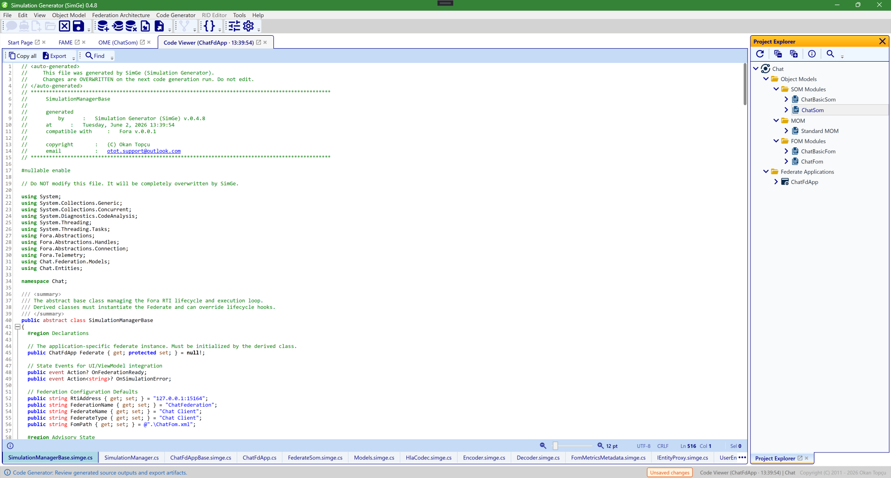

# Code Generator

*Last Updated (DTG): 2026-10-12*

This page documents the current **Fora-only** code generation flow in SimGe.

It explains:
- which generator classes participate in a Fora run
- which settings change the generated output
- which metric-driven strategies are available
- when each strategy becomes active

This document does **not** cover legacy RACoN / HLA 1.3 / HLA 1516e generators.

For definitions of the structural metrics behind analysis guidance, see the [published metric reference](MetricsReports.md#metric-definitions-and-published-reference). This page describes generation controls and output behavior.



*The generated **code viewer** for a federate (here `ChatFdApp`). After a generation run, SimGe opens the produced C# files for read-only review — each generated file is a tab along the bottom — and you can copy (Ctrl+C) or export (Ctrl+E) the source. **Open Folder** in the toolbar opens that generation run's federate output folder in Windows Explorer (including `Generated/`, manual scaffolds and `Fom/`). It is disabled if the folder no longer exists. Generation is configured in the project's **Code Generator settings** (see [Project Structure & Settings](ProjectSettings.md)) and summarized in a per-federate report afterwards.*

---

## Scope

The Fora generator is selected when:

- `CodeGeneratorSettings.RtiLibraryType = HLA2025_Fora`

The entry point is:

- `SimGe.Application/CodeGenerator/CodeGeneratorManager.cs`

The main execution path is:

1. metric analysis is computed for the federate SOM
2. per-class `ClassGenStrategy` objects are derived
3. base Fora generators run
4. optional metric-driven variant generators run

---

## Main Flow

For a Fora generation run, `CCodeGeneratorManager.generateFora(...)` currently emits:

1. `CSimMngrClassGenerator_Fora`
2. `CFederateClassGenerator_Fora`
3. `CFederateManualClassGenerator`
4. `CSomClassGenerator_Fora`
5. `CModelsGenerator_Fora`
6. `CHlaCodecGenerator_Fora`
7. `CEncoderGenerator_Fora`
8. `CDecoderGenerator_Fora`
9. `CEntityGenerator_Fora`
10. `CDatatypeGenerator`
11. `CTagsGenerator`
12. `CGeneratedReadmeGenerator_Fora`

If metric-driven variants are enabled, it also emits:

13. `CSpecializedCodecGenerator_Fora`
14. `CDeltaTrackerGenerator_Fora`

---

## Planned: Service-Driven Generation

A planned Fora enhancement is to synchronize generated code with the OMT **Services** usage table.

Target behavior:

- generate service-related boilerplate only when the corresponding service is marked `Used`
- reduce unused lifecycle/helper code in `SimulationManagerBase.simge.cs`
- reduce unused callback scaffolding in the generated Fora federate base where possible

Constraint:

- methods required by the Fora interfaces will still need to exist for type compliance; planning focuses on suppressing extra wrappers, helpers, and optional boilerplate around unused services

---

## Generated Structure

Typical Fora output is organized like this:

```text
Generated/
  Core/
    [Federate]Base.simge.cs
    SimulationManagerBase.simge.cs
  Som/
    FederateSom.simge.cs
  Models/
    Models.simge.cs
    HlaCodec.simge.cs
    Encoder.simge.cs
    Decoder.simge.cs
    Datatypes.simge.cs
    Tags.simge.cs
    SpecializedCodecs/
      [Class]Codec.simge.cs
    Delta/
      [Class]DeltaTracker.simge.cs
  Entities/
    IEntityProxy.simge.cs
    [Class]Entity.simge.g.cs

Entities/
  [Class]Entity.cs

Fom/
  [Module].xml

SimulationManager.cs
[Federate].cs
[Fom].xml
[Fom].fed
README.generated.md
```

Notes:

- `Generated/` is machine-owned and may be overwritten on regeneration.
- `Entities/[Class]Entity.cs` and `SimulationManager.cs` are user scaffolds.
- `SpecializedCodecs/` and `Delta/` appear only when metric-driven variants are active and applicable.
- `README.generated.md` is emitted at the federate output root and summarizes the generated API surface, target compatibility, metric-strategy decisions, and regeneration guidance.
- `Fom/`, `[Fom].xml` and `[Fom].fed` are the FOM files described below.

---

## FOM Files

Code generation writes the FOM the generated code supplies to the RTI, based on the federation's FOM modules on the FAME [Federation tab](FAME.md#the-federation-tab):

- `Fom/` holds every module of the federation's FOM, its dependencies included, plus the application's join modules and a user-extended MIM. A module is copied from the XML file the project imported it from, so the RTI reads the same content; a module without that file is exported as IEEE 1516-2025 XML. Each file is named by its designator, the module's file name.
- `[Fom].xml` is the composed FOM as a single FDD (IEEE 1516-2025 for Fora, IEEE 1516-2010 for the other RTI targets), and `[Fom].fed` the same FOM as an HLA 1.3 FED, for RTIs that take one file. Both are named after the federation's first FOM module and written at the output root.

The generated `SimulationManagerBase` lists the modules in load order:

```csharp
public IReadOnlyList<string> FomModules { get; set; } = [@"RPR-Base_v3.0.xml", @"RPR-Physical_v3.0.xml"];
public IReadOnlyList<string> JoinFomModules { get; set; } = [];
public string? MimModule { get; set; } = null;
public string? LogicalTimeImplementationName { get; set; } = null;
public string FomModuleFolder { get; set; } = @"Fom";
```

`RunAsync` creates the federation with these modules (IEEE 1516.1-2025 §4.5), reading each file with `FomModuleSource.FromFile` and sending its content, so the RTI host needs no copy of the files. A relative designator is looked up in `FomModuleFolder` under the working directory, then under the application directory; copy `Fom/` next to the executable, or set the properties before calling `RunAsync`. The application then joins with `JoinFomModules` when it has any (§4.11). Only `HlaFederationExecutionAlreadyExists` is ignored at creation, so a federate that finds the federation already created carries on; any other rejection, such as conflicting modules, reaches the caller. When `FomModules` is empty, the federation is created from the single `FomPath`.

Missing dependencies, conflicting modules and files that could not be written are reported as `CG1030` warnings in the code generation diagnostics.

---

## Generated API Summary README

For each Fora federate output, SimGe writes:

- `README.generated.md`

The README is generated into the same root folder as `SimulationManager.cs`, `[Federate].cs`, and the `Generated/` tree. For example:

```text
C:\ProgramData\SimGe\Samples\Chat\SourceCode\[timestamp]\ChatFdApp\README.generated.md
```

It is intended for simulation developers who need to understand the generated integration surface without reading every generated C# file.

The README includes:

- generation provenance: output path, timestamp, SimGe version, target, HLA version, namespace root
- Fora API profile: the committed `ForaClientApiProfile.json` profile ID, minimum/tested `Fora.Client` version, required package, API namespace surface, SDK assemblies that provide that surface, and .NET/C# target expectations. If generated code is placed near a target `.csproj`, the README also reports the resolved target project version as secondary validation metadata.
- generated vs scaffold file ownership
- metric-based generation settings and emitted variant status
- per-object-class strategy results, including hotspot, periodic, critical, specialized-codec, delta-tracker, and critical-wrapper decisions
- analytical synthesis diagnostics such as `CG1010`
- object-class API summary: generated model, entity wrapper, registration helper, lifecycle events, and attributes
- interaction-class API summary: DTO, sender helper, receive event, and parameters
- DDM dimension handles
- generated datatype and codec/converter summary
- common advisory queries/events, switch/session lifetime, sending-policy limits and migration of public advisory overrides
- recommended extension points in `SimulationManager.cs` and `[Federate].cs`
- regeneration notes for syncing the output into a target Fora application

The README is regenerated on each run and should be treated as generated documentation, not hand-edited source.

SimGe does not require `Fora.Client` as a NuGet dependency in order to generate code. The generator reports the embedded Fora API profile it was authored and tested against. End-user projects must reference a compatible `Fora.Client` package or project when compiling the generated code.

For SimGe **0.5.4**, the embedded profile is **HLA2025-ForaClient-20260720**, with minimum and tested `Fora.Client` version **20260720.1.0**, targeting **.NET 10 / C# 14**. Use the profile recorded in a fresh `README.generated.md` when checking an existing application's package references. A newer package version still requires compatibility verification.

Generated `IFederateAmbassador` object and interaction callbacks require Fora commit **`660ee9b`** or a later compatible build of `20260720.1.0`. The version prefix alone cannot distinguish older builds with incompatible signatures. The generator follows IEEE 1516.1-2025 §6.9, §6.11, §6.13, §6.15 and §6.17: receive-order callbacks use `OrderType.Receive`, timestamped callbacks retain their sent order and logical time, and `MessageMetadata.Transport` is a `TransportationTypeHandle`. The callback signatures accept producing federate, optional sent regions and optional retraction handles; regular interaction hooks expose the sent regions through `MessageMetadata.SentRegions` for DDM matching while the callback is active. Producing-federate and retraction values, and sent regions on attribute-reflection hooks, are not currently forwarded.

The generated manager selects `CallbackModel.Evoked` at `ConnectAsync` and calls `EvokeMultipleCallbacksAsync` in its heartbeat loop. It does not call `EnableAsynchronousDeliveryAsync` before joining the federation. This matches Fora's §4.1/§4.2 callback model behavior and the §10.57/§10.58 Evoke services.

The standard client interface is `IForaClient`. Scenario annotations use the optional `IForaTelemetry` capability; generated `SetScenarioStep` calls do nothing when the client does not provide that capability. Clock-alignment probes belong to `IForaClockProbe`. When adapting hand-written scenario code, use the appropriate optional capability rather than calling these extensions through `IForaClient`. See [Fora Telemetry & Validation](ForaTelemetry.md).

---

## Fora Contract Validation

For Fora generation runs, SimGe validates the generator's intended `Fora.Client` usage against the bundled API contract snapshot before reporting success.

The validation answers this question:

```text
Do the Fora service and codec calls emitted by this generator still exist with the expected signatures in the targeted Fora API snapshot?
```

The current validator checks:

- 55 generated Fora service-call shapes, including lifecycle (creation and join with FOM module sources), handle resolution, publish/subscribe, object registration, encoded update/send helpers, advisory switches, late-join attribute-value requests, and cleanup
- 28 generated `Fora.Encoding.HlaPrimitives` codec-call shapes
- the configured `Fora.Client` contract snapshot recorded by `ForaClientApiProfile.json`

The result is shown in the code-generation report, for example:

```text
FORA CONTRACT VALIDATION
  INFO  [CG1020] Fora.Client API contract validation passed (55 service call(s), 28 codec call(s)).
```

If the bundled contract snapshot is missing, generation is not blocked; the validator reports `NotRun` so the missing validation is visible. If a required API member or signature does not match, SimGe reports a `CG1021` issue so generator/Fora compatibility can be fixed before relying on the generated code.

Internally, generated Fora service-call emission is routed through `ForaClientCallWriter`. This keeps the generator templates from scattering raw `Fora.Client` method strings across many files. The writer is not the API source of truth; the bundled DLL metadata snapshot remains the validation source of truth.

---

## Settings

The most important Fora settings are in:

- `SimGe.Application/CodeGenerator/CodeGeneratorSettings.cs`

### Core Selector

| Setting | Meaning |
|---|---|
| `RtiLibraryType = HLA2025_Fora` | activates the Fora generator path |

### Metric-Driven Settings

| Setting | Default | Effect |
|---|---:|---|
| `EnableMetricDrivenVariants` | `false` | turns metric-driven generator branches on |
| `SaturationThreshold` | `0.6` | hotspot threshold used by `MetricEngine` |
| `DispersionThreshold` | `1.0` | extra hotspot threshold based on relative payload |
| `EmitDispatchTable` | `true` | allows generated dispatch-table branches when metric mode is enabled |

Important behavior:

- if `EnableMetricDrivenVariants = false`, SimGe uses standard Fora generation without metric-conditioned variants
- metric-mode `_dispatchNames` is a diagnostic Type → FOM-name map, gated by `EnableMetricDrivenVariants && EmitDispatchTable`
- actual cached callback routing is independently selected by `EnableCachedDispatchTables`; the object-family decoder still uses a linear class-handle chain

### Fora Telemetry Settings

**Enable Fora Telemetry** (`EnableForaTelemetry`, default `false`) enables instrumentation in the generated code. See [Fora Telemetry & Validation](ForaTelemetry.md) for capture and inspection steps. Scenario annotations additionally require a client that supports `IForaTelemetry`.

### SOM capabilities (production)

For Fora SOM generation, the SOM declares the capabilities this federate supports. Inactive leaf classes and `Neither` attributes have no generated payload, codec, entity member or handle lookup. Required ancestors, inherited active members and datatype/directed-interaction dependencies remain. P/PS attribute sets are published; S/PS sets are subscribed, and an empty set emits no attribute P/S call. Entity state exposes the union; encoders and update helpers use publishable attributes, decoders and discovery requests use subscribable attributes.

To support a previously `Neither` member, change the SOM and regenerate. Complete FOM schema emission remains complete; the XML sent to the RTI is not reduced by this selection. If an older user-owned entity scaffold refers to a removed capability, adapt or remove that scaffold yourself. This production rule is separate from experimental workload pruning and from runtime advisory switches. See SOM Capability Selection.

### Inactive-branch pruning (experimental / programmatic)

`EnableInactiveBranchPruning` defaults to `false`. It is used by the experimental generation/campaign path and is not currently exposed as a checkbox in the Code Generator settings UI. It is separate from the metric-driven variant switch.

Pruning requires both the switch and a per-run set of eligible class names. The caller supplies workload reachability, external-reference, and modular-dependency information to the eligibility evaluator. A branch qualifies only when it has no exchange-participating class, contributes no inherited members to an active class, is not referenced by another generated artifact, is unreachable under the supplied workload, and is not needed for modular resolution. A class's Publish/Subscribe value alone is insufficient.

For eligible branches, generation suppresses the affected class artifacts. In 0.5.2 this also covers SOM object-class, interaction-class, attribute, and parameter handle declarations and their `InitHandlesAsync` RTI lookups. Base MIM handles (`HLAobjectRoot`, `HLAinteractionRoot`, and `HLAprivilegeToDeleteObject`) remain, as do the `FomMetricsMetadata.simge.cs` design-time snapshots when emitted. Pruning changes generated output; it does not delete classes from the source model.

Re-evaluate eligibility whenever the workload or model dependencies change. The class-name set and emission counters are computed for each run and are not stored as project state. The behavior descriptions below refer to retained classes when this experimental option is active.

---

## Metric Pipeline

The current Fora metric path is:

1. `MetricAnalysisService.Analyze(...)`
2. `MetricEngine.Compute(...)`
3. `ClassGenStrategy.FromSnapshot(...)`

### Shared Metric Source

The generator no longer uses a fully separate placeholder metric model.

The code generation layer now derives its class snapshots from the same shared analysis family used by dashboard statistics:

- `SimGe.Model/Helpers/Metrics/MetricAnalysisCore.cs`
- `SimGe.Model/Helpers/Metrics/MetricAnalysisService.cs`
- `SimGe.Model/Helpers/Metrics/MetricAnalysisResult.cs`

This reduces drift between dashboard interpretation and code generation decisions.

### Current Strategy Inputs

`ClassGenStrategy` currently carries:

- `IsHotspot`
- `IsAnemic`
- `IsCritical`
- `IsPopulationGated`
- `IsPeriodic`
- `IsConditional`
- `IsStatic`
- `EmitSpecializedCodec`
- `EmitDeltaTracker`

Derived outputs today are:

- `EmitSpecializedCodec = EnableMetricDrivenVariants && IsHotspot`
- `EmitDeltaTracker = EnableMetricDrivenVariants && IsHotspot && IsPeriodic`

---

## Strategy Matrix

This is the current Fora behavior.

| Condition | Result |
|---|---|
| `EnableMetricDrivenVariants = false` | no specialized codec files, no delta tracker files, no metric-driven dispatch tables |
| `IsHotspot = true` | encoder/decoder may delegate to a specialized codec |
| `IsHotspot = true` and class is an **Object Class** | `CSpecializedCodecGenerator_Fora` emits `Generated/Models/SpecializedCodecs/[Class]Codec.simge.cs` |
| `IsHotspot = true` and `IsPeriodic = true` and class is an **Object Class** | `CDeltaTrackerGenerator_Fora` emits `Generated/Models/Delta/[Class]DeltaTracker.simge.cs` |
| `IsCritical = true` | generated `SimulationManagerBase` wraps register/update helpers in a `try/catch` and calls `OnCriticalFault(...)` |
| `EmitDispatchTable = true` and metric mode is enabled | generated federate includes the diagnostic `_dispatchNames` map; cached callback routing is separately enabled by `EnableCachedDispatchTables` |

---

## Runtime Interpretation of Metric-Driven Variants

Metric-driven variants are intended to affect runtime behavior, not only generated-file
organization. Their current implementation has the following exact boundaries:

| Variant | Runtime value | Current limitation |
|---|---|---|
| Specialized codecs | Hotspot Object Class encode/decode calls delegate to a class-specific codec with explicit per-attribute statements and exact-capacity dictionaries. | Generated only for Object Classes; Interaction Classes still use the normal generated encoder/decoder methods. |
| Delta trackers | Periodic hotspot Object Classes receive a `GetDelta(...)` helper that compares consecutive DTO snapshots and returns a partial DTO containing changed attributes. | The default `UpdateAsync(...)` method does not automatically compute a delta. Scenario code must call `GetDelta(...)` and then pass the returned partial DTO to the update path. |
| Dispatch-name metadata / cached routing | Metric mode emits a Type → FOM-name map. Independent `EnableCachedDispatchTables` emits handle-to-ordinal maps built after handle resolution. | The diagnostic map does not route callbacks. Cached routing covers selected callback families; object-family decoding remains linear. |
| Critical wrappers | Critical Object Class registration and update helpers call `OnCriticalFault(...)` inside generated `try/catch` wrappers and then rethrow. | The wrapper is limited to generated object registration/update helpers. |

Therefore the feature is implemented, but performance claims should be read as generated runtime
strategy potential rather than benchmark evidence. Actual speedup or bandwidth reduction depends
on the FOM shape, update frequency, payload sizes, subscriber topology, and whether scenario code
uses the generated delta helper for periodic hotspot objects.

---

## Current Generator Behaviors

### `CEncoderGenerator_Fora`

Behavior:

- emits interaction encoders for retained classes
- emits object encoders for retained classes
- if strategy says `EmitSpecializedCodec`, object encode methods delegate to `[Class]Codec.Encode(...)`

Current scope:

- specialized delegation is applied to Object Classes
- interaction classes still use normal generated encode logic

### `CDecoderGenerator_Fora`

Behavior:

- emits interaction decoders for retained classes
- emits object-family dispatch methods, excluding pruned classes from routing
- if strategy says `EmitSpecializedCodec`, object decode methods delegate to `[Class]Codec.Decode(...)`
- object-family decoding emits a linear class-handle chain; it is not replaced by metric-mode `_dispatchNames`

### `CEntityGenerator_Fora`

Behavior:

- emits generated entity proxy partials for retained object classes
- emits user scaffold entity files for retained object classes
- if strategy says `EmitDeltaTracker`, entity proxy includes a delta-tracking hook

Important fix:

- the delta hook is now gated by `EmitDeltaTracker`, not merely by `IsPeriodic`
- this prevents generated entities from referencing tracker classes that were never emitted

### `CSimMngrClassGenerator_Fora`

Behavior:

- always emits generated `SimulationManagerBase`
- always emits `SimulationManager.cs` scaffold
- if strategy says `IsCritical`, generated register/update helpers wrap their body in `try/catch`

Current critical hook:

- `protected virtual void OnCriticalFault(string className, Exception ex)`

#### Generated `SimulationManagerBase.simge.cs` API & Lifecycle

The generated `SimulationManagerBase` defines the IEEE 1516-2025 async federation lifecycle. Its key API components include:

##### 1. Configuration Properties
- `RtiAddress`: The connection address for the RTI.
- `FederationName`: The name of the target federation execution.
- `FederateName` & `FederateType`: Identifiers for the federate execution.
- `FomPath`: Path to the single FDD/FOM XML file (defaults to the project's generated FOM).
- `FomModules`: A list of modular FOM paths (`IReadOnlyList<string>`). When populated, it triggers the multi-module federation creation.

##### 2. The `RunAsync` Orchestration
Call the generated, non-virtual `RunAsync(CancellationToken ct = default)`; customize lifecycle hooks in the manual subclass. It uses `CallbackModel.Evoked` and creates the federation conditionally:

- With `FomModules`, it loads each local file into `FomModuleSource` content, using the ordered module-source overload with optional `MimModule` and `LogicalTimeImplementationName`.
- Without modules, it uses the single-file `FomPath` overload.
- Join uses the additional module-source overload when `JoinFomModules` is populated.

These calls are emitted through `ForaClientCallWriter`; the module path list itself is not sent as module content. Set the file properties before starting and deploy `Fom/` with the executable. See [FOM Files](#fom-files) for resolution and failure behavior. `finally` runs cleanup for completed lifecycle steps and disposes the client. Common advisory observations reset at session start and cleanup.

##### 3. Virtual Hook `OnPublishAndSubscribeAsync`
The generator emits a virtual method containing all default publish and subscribe calls derived from the SOM design:
`protected virtual async Task OnPublishAndSubscribeAsync(CancellationToken ct)`
This method can be overridden in the user subclass `SimulationManager.cs` to customize, extend, or defer P/S logic within the capabilities retained by the SOM. It does not provide generated support for `Neither` members; change the SOM and regenerate to add those capabilities.

##### 4. Register Methods
The base class exposes type-safe registration methods for object classes, such as `Register[Class]Async` (e.g., `RegisterHumanAsync`). These methods register object instances with the RTI and return the corresponding generated entity wrapper.

##### 5. Declared Object Instances
When the [Object Instance Registry](ObjectInstanceRegistry.md) of the federate application being generated (its behavior, edited in the [Federate Behavior Editor](FederateBehaviorEditor.md)) declares instances, the base class also reserves the declared names while the federate starts, registers each instance with its name only after the RTI confirmed the reservation (IEEE 1516.1-2025 §6.2 – §6.8), and exposes `DeclaredInstances` and `Register[Class]InstancesAsync` for on-demand declarations. A refused reservation fails the run with `InstanceNameReservationException`. For a declaration configured to send initial values, those values are passed to the register method and sent with the first update after registration. When configured to send only on request, the entity state is seeded locally instead. An `AdvisoryDriven` declaration registers from the heartbeat after Start Registration advice; a class being P alone or having its switches enabled is insufficient to synthesize that declaration. Attributes the declaration leaves empty come from the `protected virtual <Declaration>InitialValues()` hook (the values only the program knows), and `<Declaration>Instances` gives the registered instances as entities. Declarations with errors stop generation (`CG5001`–`CG5009`); declarations of an unpublished class are skipped with a warning.

##### 6. Deferred Work, Event Context and Entity Events
Three pieces of plumbing every federate needs are generated, so they do not have to be written by hand:

- `Defer(Func<CancellationToken, Task> work)` queues an RTI call that an RTI callback decides to make (an event handler, an override of a federate callback). The heartbeat runs the queue before `OnSimulationStepAsync`, outside the callback. A failure is reported through `RuntimeErrorOccurred` and the compatible `DeferredWorkFailed`; by default the next item still runs. The manual `ShouldStopOnDeferredWorkFailure` policy can stop instead (see §12).
- `EventContext` is the `SynchronizationContext` the manager's events are raised on. It is null by default, which raises them on the thread that received the RTI callback. A user interface sets it once (for example to the context captured on its thread) instead of moving every event to its thread. It covers `OnFederationReady`, `OnSimulationError`, manager `RtiLogged` and `RuntimeErrorOccurred`, the advisory notifications below, the entity events below and the events you declare in `SimulationManager` and raise with `RaiseEvent(...)`. The generated code refers to no user-interface framework.
- For every object class the federate subscribes to, `<Class>Discovered`, `<Class>Updated` and `<Class>Removed` pass the class's entity. The generated code wraps the entity, applies the reflected attributes and releases it when the object is removed. Override `On<Class>Discovered`, `On<Class>Updated` or `On<Class>Removed` (they take the entity) for what must happen on the callback's thread; the hook runs before the event.

```csharp
protected override void OnChatGroupRemoved(ChatGroupEntity entity)
{
  if (entity.GroupIndex is { } index)
    Defer(ct => DropGroupRegionAsync(index, ct));   // an RTI call: queued, not made inside the callback
  RaiseEvent(GroupRemoved, entity);                  // raised on EventContext
}
```

The federate's own `<Class>Discovered`, `<Class>Reflected` and `<Class>Removed` events still run first, so handlers written against them keep working after regeneration. A member of your `SimulationManager` that has the name of a generated event has to be renamed; the compiler reports the clash.

##### 7. DDM Regions
When the FOM gives an interaction class DDM dimensions (the Chat model: `ChatMessage` and the `Group` dimension; the Restaurant model: `MainCourseServed` and `ServerId`), the generated manager has a helper to open regions on them. The model supplies the dimension and its upper bound; **you choose the range**, in whatever units your federation uses. The generated code does not interpret the range.

```csharp
// Open a region (here one room of a chat: the range [index, index + 1) of Group) and receive ChatMessage through it
GroupRegion room = await GroupRegions.OpenRegionAsync(index, index + 1, [Federate.Som.ChatMessageHandle]);

// Send into the region: only federates whose regions overlap it receive the message
await SendChatMessageAsync(new ChatMessage { ... }, room, tag);

// Receive: the regions you opened that the message was sent to
ChatMessageReceivedInRegion += (message, qos, rooms) => { foreach (var r in rooms) Show((int)r.Lower, message); };

// Leave: the region is unsubscribed and deleted
await room.CloseRegionAsync();

// A federate that wants every range opens one region over all of them
await GroupRegions.OpenAllRegionsAsync([Federate.Som.ChatMessageHandle]);
```

**The DDM design.** The regions you design in the [DDM tab](DdmDesign.md) need no helper call. For every region a class or a declaration refers to, the manager has `Get<Region>RegionAsync()`; the classes that subscribe with a region are subscribed with it when the federation is ready, and not the usual way (interaction classes, and the attributes of object classes); an interaction class that sends with a region gets `Send<Class>To<Region>Async(dto)`, and one that subscribes with it gets the event `<Class>ReceivedIn<Region>Region`, raised for what was sent to a region overlapping that region; the subscriptions are removed and the regions deleted before the federate resigns. A declaration of the Object Instance Registry that names a region registers its instances with it, and shares the region with the classes that use it. Problems are reported as `CG5013` – `CG5019`.

Subscribing a class with a region replaces its usual subscription: the usual one covers every range and, with it in place, the region would filter nothing. The helper drops it for you the first time you subscribe the class with a region. An interaction sent without a region (`SendXAsync(dto)`) still reaches every region subscriber. Only classes that have dimensions and that the SOM subscribes to can be subscribed with a region. `MatchAsync(metadata)` is available when you handle the interaction yourself (see Code Generator, chapter 11 §6.6).

##### 8. Common Advisory Observations

Every generated federate base contains `FederateAdvisoryState`; both the federate and manager expose the same instance as `Advisories`. You no longer need a separate registration flag, a communication-wide boolean or a dictionary for each attribute callback. This infrastructure is generated even without declared object instances, with metric mode Off, and with advisory switches initially Off.

| Query | Meaning |
|---|---|
| `GetRegistration(objectClass)` | Last Start/Stop Registration advice for that class |
| `GetInteractionRelevance(interactionClass)` | Last Turn Interactions On/Off advice for that class |
| `GetAttributeRelevance(instance, attribute)` | Publisher's last Turn Updates On/Off advice for that attribute of that instance |
| `GetAttributeScope(instance, attribute)` | Receiver's last In/Out Of Scope advice; independent of publisher relevance |
| `GetUpdateRateDesignator(instance, attribute)` | Last rate-designator string from update-On, or null; no scheduling is implied |

Each status is `Unknown`, `On` or `Off`. **Unknown means no current observation**, not an Off callback or permission to send. Different classes, instances and attributes remain independent; an Off for one attribute leaves the others unchanged.

The following client fragment assumes a Chat SOM that publishes `ChatMessage`, and a manager already initialized with its federate. Replace the class handle with the one in your generated SOM. UI rendering belongs to the application:

```csharp
#region Observe interaction relevance
manager.EventContext = SynchronizationContext.Current; // Capture on the UI thread; null is valid for a console.
manager.InteractionRelevanceChanged += change =>
    ShowStatus(change.InteractionClass, change.Status);

var status = manager.Advisories.GetInteractionRelevance(
    manager.Federate.Som.ChatMessageHandle);
#endregion
```

The manager provides `AdvisoryChanged` for all categories, plus `RegistrationAdvisoryChanged`, `InteractionRelevanceChanged`, `AttributeRelevanceChanged` and `AttributeScopeChanged`. The `AdvisoryChange` carries typed handles, changed attributes as an immutable detached set, status and an optional rate designator. Identical observations are deduplicated; a different rate still produces a change. State is committed on the callback thread before application advisory hooks. Manager events use `EventContext`; a delayed event describes the transition when it occurred, so query `Advisories` for current state. Direct state events use the calling thread.

**Managed switches.** Use the generated setters; they call the RTI before changing the tracked flag. A failed RTI call preserves observations. A successful transition invalidates only that category and raises `AdvisorySwitchChanged`; enabling starts Unknown until a callback arrives. Attribute relevance need not replay existing state. Callbacks received while a category is disabled do not update observations. Runtime enabling supports capabilities already retained by the SOM; it does not create code for `Neither` members.

```csharp
#region Enable an initially disabled switch
await manager.SetInteractionRelevanceAdvisoryEnabledAsync(true, ct);
// Existing published-class hooks are available; the state remains Unknown until RTI advice arrives.
#endregion
```

Raw `Federate.Rti` switch calls bypass this bookkeeping. Model switch defaults initialize the configuration; session start and cleanup clear observations while retaining it (`AdvisoryStateReset`). The generated removal route and `UnregisterEntity` forget per-instance relevance/scope (`ObjectAdvisoriesRemoved` when tracked data existed).

**Regeneration migration.** The eight public advisory callback names, including both update-On overloads, are now non-virtual. Move old public overrides to the corresponding protected `Dispatch...Async` or typed `On<Class>...Async` hook. Those advisory extension points can omit a base call without suppressing common state recording. Other callbacks keep their existing API; in particular, preserve base removal routing when overriding a removal callback/dispatcher, or use the typed removal hook so instance cleanup still runs.

**Step-1 history.** Observation-only behavior was the first implementation. The current managed send/update policy is described in section 9 below; a registration callback still does not create an object without a modeled declaration or explicit application request.

See the architecture contract and review. The step-1 checks passed 109 tests, including 14 new compiled advisory cases; live EnviFd/MekoFd/Chat-Fora validation awaits fresh developer-generated exports.

##### 9. Advisory-aware sends and updates

After regenerating, use the existing generated helpers without manual relevance booleans or attribute-set filtering:

```csharp
#region Application publication
// Values are computed by your application; currentEnvironment and report are generated DTOs.
await environment.UpdateAsync(currentEnvironment, ct: ct);
await manager.SendWeatherReportAsync(report, ct: ct);
// Or set entity properties and publish their current non-null values.
await environment.UpdateAsync(ct);
#endregion
```

By default, with the relevant switch **On**, ordinary object updates send only attributes advised On. Off and Unknown keep the latest submitted values; On flushes them on the heartbeat, outside the callback. This is a latest-state buffer, not an event history. Different tags/hints remain separate messages. AttributeScope is never used to block publication. With the switch **Off**, relevance does not filter sends. Current attribute ownership is queried before a candidate is sent; a lost-ownership value is discarded rather than replayed after a later acquisition.

Normal and named/dynamic DDM interaction helpers suppress Off and, by default, Unknown. Suppressed interactions are **not replayed**. Handle `InteractionSendSuppressed` if your UI needs to show that a message was not submitted. Class-level On does not guarantee a particular DDM region overlaps a subscriber. Directed interaction helpers use target routing and do not apply ordinary interaction relevance; that advisory does not describe directed subscriptions.

```csharp
#region Optional startup and failure policy
manager.UnknownAdvisoryPolicy = SimulationManagerBase.UnknownAdvisoryBehavior.AllowUntilOff;
manager.InteractionSendSuppressed += result => ShowSuppressed(result.InteractionClass, result.Status);
// After correcting a failure, explicitly retry pending object values. Interactions are never retried here.
await manager.FlushPendingUpdatesAsync(ct);
#endregion
```

Default policy is `WaitForOn` while a relevance switch is enabled. Selecting `AllowUntilOff` permits only Unknown; an actual Off still suppresses. Changing this setting does not manufacture advice or automatically flush old values; a subsequent update, On callback or explicit flush applies it. Use the managed switch setters rather than raw RTI calls.

The generated Provide Attribute Value Update response runs through Defer, answers requested P/PS values from current entity state, and bypasses relevance while checking ownership. It does not consume unrelated pending values. Failed direct sends throw; automatic flush errors use `DeferredWorkFailed`. Successful deletion retires buffers and unregisters the entity. Cleanup clears buffers; a proxy from an ended session cannot publish into a new session. Do not wait for managed RTI helpers inside a callback: use Defer or the simulation loop.

**Registration:** for automatic Start Registration handling, configure one or more `AdvisoryDriven` instances in the Federate Behavior Editor. The heartbeat registers them once; initial values then follow the same update policy. Disabling the registration switch releases that wait. Stop Registration leaves existing objects alive. Direct `Register<Class>Async`, StartupImmediate and on-demand declarations remain explicit choices. Business decisions such as which objects exist, what their values are and when an interaction represents an event still belong to the application.

Regenerate Generated/ and preserve user-owned scaffolds. Remove duplicated manual gates when importing the new code; raw RTI update/send calls bypass this behavior. Fields set on an entity alone are not submitted until UpdateAsync is called (explicit value requests still read current entity state). Null means an omitted value. See architecture §6.4b for behavior and measurement boundaries. Step-2 application interoperability is verified after fresh exports; earlier application tests cover step 1 only.

##### 9.1. Overriding publication policies in manual SimulationManager

The above behavior is the generated **default**. Add overrides inside your manual `SimulationManager` class; do not edit `Generated/Core/SimulationManagerBase.simge.cs`. Regeneration preserves the manual file.

```csharp
#region Manual publication choices
// Add these members inside the existing manual SimulationManager class.
public bool SendDespiteAdvice { get; set; }
public bool RetainLatestValues { get; set; } = true;
public bool AutomaticFlush { get; set; } = true;

protected override bool ShouldSendInteraction(InteractionPublicationContext context)
    => SendDespiteAdvice || base.ShouldSendInteraction(context);

protected override bool ShouldSendAttribute(AttributePublicationContext context)
    => SendDespiteAdvice || base.ShouldSendAttribute(context);

protected override bool ShouldBufferAttribute(AttributePublicationContext context)
    => RetainLatestValues && base.ShouldBufferAttribute(context);

protected override bool ShouldAutomaticallyFlush(PublicationFlushContext context)
    => AutomaticFlush && base.ShouldAutomaticallyFlush(context);
#endregion
```

All three properties initially preserve the defaults. Set `SendDespiteAdvice = true` to allow Off/Unknown sends; this does not fake an advisory or bypass RTI ownership/declaration checks. Set `RetainLatestValues = false` for fresh updates that should get one send attempt and never replay after On or retry after failure. Set `AutomaticFlush = false` to retain state but choose when advice/switch-triggered pending updates are flushed:

```csharp
#region Explicit flush chosen by the application
manager.AutomaticFlush = false;
// At an application-selected point, outside an RTI callback:
await manager.FlushPendingUpdatesAsync(ct);
#endregion
```

Explicit flush still obeys `ShouldSendAttribute` and current ownership. Disabling automatic flush does not stop a new UpdateAsync from sending; override the send decision as well if updates should pause. An On callback still records state and marks retained latest values pending for later explicit refresh. Publication bookkeeping is queued before manager advisory events; an event handler may schedule a manual flush with `Defer(ct => FlushPendingUpdatesAsync(ct))` after checking the observed status. Interactions are never queued by these policies.

For finer selection, compare `context.InteractionClass` with `Federate.Som.<Class>Handle`, `context.Attribute` with `Federate.Som.<Class>_<Attribute>Handle`, or `context.Instance` with an entity's handle. Interaction context distinguishes `Ordinary`, `Region` and `Directed` via `Kind`; directed context also carries `TargetInstance`. Attribute context identifies explicit responses via `IsExplicitRequest`. Flush context distinguishes `AttributeRelevanceOn` and `RelevanceSwitchDisabled` via `Reason`. Call `base` for classes or fields whose default behavior should remain.

Returning false from the buffer hook applies when a **new ordinary value** is submitted. It also removes that attribute's old retained snapshot; a blocked or failed replacement cannot replay the older value. Merely changing the setting does not immediately clear existing buffers. Explicit value-request responses are transient and use the attribute send hook, independent of ordinary retention. Session cleanup, ownership-loss discard and stale-proxy checks remain active even with custom policies.

Hooks are synchronous decisions and can be invoked more than once. Keep them short, without RTI calls or calls back into publication helpers. They run on the caller/deferred thread; protect settings shared with a UI thread. See architecture §6.4c for the exact contract.


Fresh export integration is verified with EnviFd/MekoFd (`20261012155146`) and Chat-Fora (`20261012155209`): 17 default/override cases per actual manager pass against real Fora. Keep UI/domain code in the manual scaffolds; remove old gates that would suppress calls before the generated helpers. Envi still captures unsubmitted UI edits on its presentation thread and registers on StartRegistration; Meko retains ship delta selection; Chat retains User/room behavior. These are application choices. No production custom override is enabled by this migration. See application integration evidence.

### `CFederateClassGenerator_Fora`

Behavior:

- emits the generated federate ambassador base
- always emits the shared advisory state/types and record-before-hook advisory entry points
- retains typed advisory hooks for SOM capabilities even when the relevant model switch starts Off
- if metric mode is enabled and `EmitDispatchTable = true`, emits the generated `_dispatchNames` table

### `CSpecializedCodecGenerator_Fora`

Behavior:

- emits one file per hotspot **Object Class**
- inlines attribute encode/decode logic for that class

Current scope:

- Object Classes only
- no specialized interaction codec generator exists at the moment

### `CDeltaTrackerGenerator_Fora`

Behavior:

- emits one file per **periodic hotspot Object Class**
- compares successive DTO snapshots
- returns a partial delta DTO containing changed attributes only

Current scope:

- Object Classes only

### `CGeneratedReadmeGenerator_Fora`

Behavior:

- emits `README.generated.md` at the federate output root
- summarizes the generated object classes, interaction classes, dimensions, datatypes, helper APIs, and extension points
- records the embedded Fora API profile as the target compatibility baseline, with a resolved target-project `Fora.Client` version as additional metadata when available
- records metric-driven settings and per-class strategy outcomes
- includes analytical synthesis diagnostics collected during the generation run

Current scope:

- Fora target only
- generated after the source files so it can document the final strategy/diagnostic state of the run

---

## Current Scope Limits

The current Fora metric-driven implementation is intentionally narrower than the full strategy model.

### Object Classes vs Interaction Classes

Metric snapshots are computed for both OC and IC domains, but variant file generation is currently limited to Object Classes:

- `CSpecializedCodecGenerator_Fora` accepts `COmtOC`
- `CDeltaTrackerGenerator_Fora` accepts `COmtOC`
- `generateMetricVariants(...)` iterates only over `COmtOC`

Practical result:

- an Interaction Class can still be classified as a hotspot in strategy output
- but SimGe does not currently emit a specialized interaction codec file for it

### Delta Tracker Requirements

A delta tracker is generated only when all of these are true:

1. metric mode is enabled
2. the class is classified as a hotspot
3. the class is classified as periodic
4. the class is an Object Class

### Dispatch Tables

Dispatch-table generation is not global by default anymore.

The diagnostic `_dispatchNames` map requires `EnableMetricDrivenVariants = true` and `EmitDispatchTable = true`. Runtime cached callback routing instead requires the independent `EnableCachedDispatchTables` switch. Neither is a universal replacement for all branches, and the object-family decoder is still linear.

---

## Practical Examples

### Restaurant FOM: ServerValue variant record

This example follows `RestaurantFOMmodule-2025.xml`, supplied with IEEE Std 1516.2-2025. For the datatype definition and OME editing steps, see [Variant records: discriminants and alternatives](OME.md#variant-records-discriminants-and-alternatives).

The separate IEEE Restaurant SOM example defines a different `ServerValue`: its discriminant is `ValIndex`, and it has no `TempAgency` payload alternative. The FOM uses `Experience` and the three alternatives below. These examples should therefore not be mixed when inspecting generated code.

SimGe generates federate code from its SOM. To obtain the structure illustrated here, the generation input must preserve these FOM datatype definitions and include the `Server` attributes. The following excerpts illustrate the current Fora generator's mapping; namespaces, documentation comments, and unrelated members are omitted. They are not a fresh generation run or a complete standalone program.

#### Datatype and Server model

The generator represents the variant record as a C# `struct` with an explicit discriminant and nullable alternative fields:

```csharp
#region Restaurant FOM datatype mapping
public enum ExperienceLevel
{
    Trainee = 0,
    Apprentice = 1,
    Journeyman = 2,
    Senior = 3,
    Temporary = 4,
    Master = 5
}

public struct ServerValue
{
    public ExperienceLevel Experience;
    public bool? CoursePassed;
    public string? TempAgency;
    public int? Rating;
}
#endregion
```

`HLAboolean` maps to C# `bool`, `HLAunicodeString` to `string`, and `RateScale` (represented by `HLAinteger32BE`) to `int`. These are application types; their C# memory layout does not define the HLA encoding. In particular, `HLAboolean` is encoded using its 32-bit HLA representation.

The `Server` DTO exposes both attributes using this datatype:

```csharp
#region Server DTO excerpt
public class Server : Employee
{
    public ServerValue? Cheerfulness { get; init; }
    public ServerValue? Efficiency { get; init; }
    // Other generated members are omitted.
}
#endregion
```

Each attribute value has its own `Experience` discriminant. A null DTO attribute means that the attribute is omitted from that update. Inside a non-null `ServerValue`, null alternative fields indicate inactive alternatives.

#### Selecting an alternative in application code

The application sets the discriminant and supplies only the corresponding payload. These are three independent example values:

```csharp
#region Constructing Restaurant FOM variant values
var traineeValue = new ServerValue
{
    Experience = ExperienceLevel.Trainee,
    CoursePassed = true
};

var temporaryValue = new ServerValue
{
    Experience = ExperienceLevel.Temporary,
    TempAgency = "Example Agency"
};

var seniorValue = new ServerValue
{
    Experience = ExperienceLevel.Senior,
    Rating = 2
};
#endregion
```

The other alternative fields remain null. `CoursePassed = false` is also a valid payload: false is distinct from an absent (`null`) alternative. `HLAother` is a fallback mapping in the FOM, not an additional `ExperienceLevel` enum member.

For an existing, locally owned `ServerEntity`, application code can update only `Efficiency` through the generated helper. The call belongs in an asynchronous application method and assumes the generated types are in scope:

```csharp
#region Updating one Server attribute
await serverEntity.UpdateEfficiencyAsync(temporaryValue);
#endregion
```

The helper constructs a `Server` DTO with `Efficiency` populated and delegates to `UpdateAsync`. `Cheerfulness` is omitted from this update. The application decides when to call the helper; the FOM's `Conditional` / `Performance review` declaration does not automatically schedule a performance review or choose an alternative.

#### What the generated encoder does

The encoder writes the discriminant, selects the matching alternative, applies the required alignment, and encodes only that alternative's payload:

| `Experience` value | Required payload field | Fields that must remain null |
|---|---|---|
| `Trainee` | `CoursePassed` | `TempAgency`, `Rating` |
| `Temporary` | `TempAgency` | `CoursePassed`, `Rating` |
| Other values, through `HLAother` (including `Apprentice`, `Journeyman`, `Senior`, and `Master`) | `Rating` | `CoursePassed`, `TempAgency` |

For this FOM definition, the generated encoder throws `InvalidOperationException` if the selected payload is null or another alternative is also populated. For example, `Experience = Senior` with only `CoursePassed` set is invalid. Changing the discriminant does not automatically clear or convert existing fields; construct a new value or explicitly reset inactive fields.

The decoder reads the discriminant and reconstructs the selected payload, leaving the other alternatives null. The generated C# struct can hold several fields in memory, but a valid encoded value contains only the selected alternative.

### Standard Fora Generation

Use this when you want predictable generated code without metric-driven specialization:

- `RtiLibraryType = HLA2025_Fora`
- `EnableMetricDrivenVariants = false`

Expected result:

- normal `Encoder.simge.cs`
- normal `Decoder.simge.cs`
- no `SpecializedCodecs/`
- no `Delta/`

### Hotspot Object Class

Use this when a class has high payload concentration and you want a tighter encode/decode path:

- `EnableMetricDrivenVariants = true`
- class is classified as `IsHotspot = true`

Expected result:

- `[Class]Codec.simge.cs` is generated
- object encode/decode methods delegate to it

### Periodic Hotspot Object Class

Use this when a frequently updated object should emit smaller partial DTO updates:

- `EnableMetricDrivenVariants = true`
- `IsHotspot = true`
- `IsPeriodic = true`

Expected result:

- `[Class]Codec.simge.cs`
- `[Class]DeltaTracker.simge.cs`
- generated entity includes `GetDelta(...)`

### Critical Object Class

Use this when a class is marked with critical semantics and you want generated manager helpers to expose failures cleanly:

- `EnableMetricDrivenVariants = true`
- `IsCritical = true`

Expected result:

- generated register/update helper wraps operation in `try/catch`
- `OnCriticalFault(className, ex)` is invoked before rethrow

---

## Files to Inspect

For the current implementation, these are the most relevant files:

- `SimGe.Application/CodeGenerator/CodeGeneratorManager.cs`
- `SimGe.Application/CodeGenerator/CodeGeneratorSettings.cs`
- `SimGe.Application/CodeGenerator/ClassGenStrategy.cs`
- `SimGe.Application/CodeGenerator/Metrics/MetricEngine.cs`
- `SimGe.Application/CodeGenerator/ClassCodeGen_Encoder_Fora.cs`
- `SimGe.Application/CodeGenerator/ClassCodeGen_Decoder_Fora.cs`
- `SimGe.Application/CodeGenerator/ClassCodeGen_Entity_Fora.cs`
- `SimGe.Application/CodeGenerator/ClassCodeGen_SimMngr_Fora.cs`
- `SimGe.Application/CodeGenerator/ClassCodeGen_FdGen_Fora.cs`
- `SimGe.Application/CodeGenerator/ClassCodeGen_SpecializedCodec_Fora.cs`
- `SimGe.Application/CodeGenerator/ClassCodeGen_DeltaTracker_Fora.cs`
- `SimGe.Application/CodeGenerator/ClassCodeGen_GeneratedReadme_Fora.cs`
- `SimGe.Application/CodeGenerator/Fora/Advisories/ForaAdvisoryCode.cs`
- `SimGe.Model.Tests/ForaAdvisoryStateGenerationTests.cs`
- `SimGe.Application/CodeGenerator/Fora/ForaClientApiProfile.json`
- `SimGe.Application/CodeGenerator/Fora/ForaClientApiProfile.cs`
- `SimGe.Application/CodeGenerator/Fora/Contract/ForaClientCallCatalog.cs`
- `SimGe.Application/CodeGenerator/Fora/Contract/ForaClientApiContractValidator.cs`
- `SimGe.Application/CodeGenerator/Fora/Writing/ForaClientCallWriter.cs`
- `SimGe.Application/CodeGenerator/Fora/ApiContract/`
- `tools/Update-ForaClientApiProfile.ps1`
- `tools/Update-ForaClientApiProfile.cmd`
- `tools/Update-ForaClientApiContractSnapshot.ps1`
- `tools/Update-ForaClientApiContractSnapshot.cmd`
- `SimGe.Model/Helpers/Metrics/MetricAnalysisCore.cs`
- `SimGe.Model/Helpers/Metrics/MetricAnalysisService.cs`

---

## Summary

The current Fora code generator has two operating modes:

- standard Fora generation
- metric-driven Fora generation

Metric-driven mode currently affects:

- object encoder/decoder delegation
- object delta tracking
- diagnostic dispatch-name metadata
- critical-class manager wrappers

The most important present limitation is that specialized metric-driven file generation is currently **Object Class only**, even though the metric analysis also evaluates Interaction Classes.

---
Updated October 12, 2026

### Reading generation reports

`CG1020` checks the Fora service/codec contract; it does not compile the emitted files or validate an existing application's manual additions. Compile the generated code with those additions before accepting an import. `CG3003` can be a safe C# identifier rewrite: `Environment` becomes `EnvironmentClass` while its HLA name stays unchanged. `CG5018` explains region-only subscriptions and `CG1010` reports design hints.

Configured tag types are retained even when no payload uses them (for example Chat `QoS`). A SOM attribute with `Neither` is deliberately absent; if manual code still needs it, change the SOM capability and regenerate. Keep wire definitions such as dimension names consistent with the FOM: Chat now uses `Channel` for General, Announcements and dynamic rooms, while `User.NickName` is PS.

## 10. Customizing declared object lifecycle

In the application's Federate Behavior Editor, add an Object Instance Registry declaration for a class the SOM publishes. Choose Count, naming strategy and a trigger. For EnviFd: **Environment**, **Count 1**, **Autonomous**, **Advisory-Driven**, with Object Class Relevance Advisory enabled in the SOM. Save and regenerate. The nstmss Envi behavior file has this declaration now; reload an already-open project before saving it so its in-memory behavior includes the change.

The generated runtime registers outside callbacks, tracks the declared entities and clears their state on cleanup. Default Stop Registration keeps the existing instance. StartupImmediate starts automatically, AdvisoryDriven waits for On, and OnDemand requires `Register<Key>InstancesAsync`. If the object-class relevance switch is disabled at runtime, AdvisoryDriven defaults to allowing registration.

For Envi the C# key is `EnvironmentClass` because `Environment` needs identifier disambiguation. Its manual manager only supplies runtime values:

```csharp
// Read a detached snapshot captured by the UI, not the UI controls on the RTI thread.
protected override NavySim.Federation.Models.EnvironmentClass EnvironmentClassInitialValues()
    => latestEnvironmentSnapshot ?? new();

// Access the generated tracked entity; no separate instance field is needed.
var environment = EnvironmentClassInstances.FirstOrDefault();
```

Adapt the namespace to the imported application. Keep initial values configured in the model as static values: the hook supplies only attributes the declaration leaves unset. Initial traffic is still governed by publication/ownership policies.

For a multi-instance declaration, override the overload with `DeclaredInstanceInitialValuesContext`: `context.Index` is the stable zero-based slot, `context.Declaration` identifies the declaration and `context.ReservedName` is the configured name (null for Autonomous). A replacement gets the same slot index, so initialization is deterministic across retries. For example, a two-Aircraft declaration can return `new() { Callsign = $"Aircraft-{context.Index + 1}" }`. The default overload calls the parameterless hook, preserving existing manual overrides.

A custom manual SimulationManager can delay all registrations, including explicit requests, until the application is ready:

```csharp
protected override bool ShouldRegisterDeclaredInstance(DeclaredInstanceLifecycleContext context)
    => applicationReady && base.ShouldRegisterDeclaredInstance(context);
```

Or opt into deleting a particular declaration on actual Off:

```csharp
protected override bool ShouldDeleteDeclaredInstances(DeclaredInstanceLifecycleContext context)
    => context.Declaration.Key == "EnvironmentClass"
       && context.AdvisoryEnabled
       && context.RegistrationStatus == AdvisoryStatus.Off;
```

Returning true from registration can force timing without manufacturing an On callback. It does not grant attributes absent from the SOM. Automatic deletion defaults to false. While a custom deletion decision remains true, the empty declaration is not automatically recreated. Explicit commands remain available:

```csharp
await RegisterEnvironmentClassInstancesAsync(ct);
await DeleteDeclaredInstancesAsync(DeclaredInstances[0], ct);
```

From an RTI callback, enqueue these calls with `Defer`; do not block the callback. Prefer queuing external application commands through the simulation loop as well. Override `OnDeclaredInstanceRegisteredAsync` for setup after tracking, and `OnDeclaredInstanceUnregistered` for local removal observation. Registration hooks run under the declaration gate: enqueue a subsequent registry operation rather than awaiting it in the hook. `ProcessDeclaredInstanceLifecycleAsync` is virtual if the whole automatic orchestration needs replacing.

Registration/deletion is serialized per declaration. A partial registration failure can be retried without duplicating completed slots; a failed RTI delete stays tracked. If RTI deletion succeeds but releasing its name fails, the slot is still removed and the release error is surfaced; stop/reconnect when the reservation state needs reconciliation. Direct successful entity deletion clears the slot too. Named replacements reserve released names again. Default automatic declarations refill missing slots when eligible, so choose OnDemand or veto registration when removal should be permanent. Cleanup resets declarations for a new session. These policies affect generated application behavior and add no new Fora service.

## 11. Where to put manual code

The generated base classes already implement P/S from **SOM** capabilities, Behavior DDM subscriptions, advisory observations, managed sends and declared object lifecycle. Fresh `SimulationManager.cs` and federate scaffolds have no empty lifecycle overrides. You can run with inherited defaults and add only the application work you need.

| Requirement | Manual file / extension |
|---|---|
| Keep default managed update On/Off and automatic On flush | No override. Use generated update/entity helpers. |
| Change send, buffer or automatic flush policy | `SimulationManager.cs`: the four [publication decision hooks](#91-overriding-publication-policies-in-manual-simulationmanager). |
| Display advisory state or pause/resume local calculations | Subscribe to manager events such as `AttributeRelevanceChanged`. Set `EventContext` to your UI context if appropriate; delayed events describe a past observation, so read `Advisories` for the current state. |
| Add an application reaction at callback time | Federate file: the actual protected `On<Class>...` hook listed in the generated base/API guide. Bookkeeping happens before the hook. Keep it short and defer RTI work. |
| Custom P/S, one-time startup, periodic application work | Add `OnPublishAndSubscribeAsync`, `OnSimulationStartedAsync`, or `OnSimulationStepAsync` in the manager only as needed. |
| Fixed object creation/deletion | Behavior Object Instance Registry and the lifecycle extension points in §10. |
| Dynamic domain objects | Generated registration factories/entity deletion from your domain logic. |

### Example: change a manager policy without callback overrides

Add these members inside your manual manager. Ordinary updates can be paused by the application; explicit value requests keep their default response policy. Automatic flush is disabled independently; call `FlushPendingUpdatesAsync(ct)` later from the simulation loop or deferred work. That explicit flush still applies send and ownership checks.

```csharp
#region Optional application publication policy
public bool ApplicationSendingEnabled { get; set; } = true;

protected override bool ShouldSendAttribute(AttributePublicationContext context)
  => (context.IsExplicitRequest || ApplicationSendingEnabled)
     && base.ShouldSendAttribute(context);

protected override bool ShouldAutomaticallyFlush(PublicationFlushContext context) => false;
#endregion
```

This is an example opt-in policy, not generated application configuration. Without these overrides the defaults remain enabled. `ShouldBufferAttribute` changes ordinary latest-value retention; interactions are never buffered/replayed. These decisions do not modify recorded On/Off or the model's available capabilities.

### Example: observe On/Off for application status

In the manual manager constructor, after `InitializeBase(...)`, subscribe to `AttributeRelevanceChanged`. The event includes `Instance`, `Attributes`, `Status` and optional rate information. Map these to application/UI state. Do not reimplement the generated publication gate or buffering in this handler.

```csharp
#region Optional advisory observation
AttributeRelevanceChanged += change =>
{
  // Optional application status, not the managed send decision.
  LastObservedStatus = change.Status;
};
#endregion
```

Define `public AdvisoryStatus LastObservedStatus { get; private set; }` in your manager if using this example. For calculation scheduling, consider each affected instance/attribute and all remaining relevant fields; an Off for one attribute is not a request to stop every calculation. Also handle Unknown, disabled-switch fallback and reset/removal if keeping application-specific state. The generated advisory store already handles those transitions.

### Example: an additional federate reaction

For a model containing published `Aircraft.Count`, an optional hook can pause its corresponding computation. Use **your model's** hook and handle names; `README.generated.md` lists the actual ones. This illustrative model is not embedded in the scaffold.

```csharp
#region Optional local calculation reaction
protected override Task OnAircraftUpdatesTurnedOffAsync(
    ObjectInstanceHandle instance, IReadOnlySet<AttributeHandle> attributes)
{
  if (instance == MyAircraftHandle && attributes.Contains(Som.Aircraft_CountHandle))
    CountingEnabled = false;
  return Task.CompletedTask;
}
#endregion
```

`MyAircraftHandle` and `CountingEnabled` are application-owned members for this example. Resume that calculation in the matching On hook if needed and reconcile switch/session transitions. A base call is not required to preserve advisory recording, because the non-virtual entry callback records first. This hook is unnecessary just to suppress Off updates. Do not call RTI inline; use your manager's `Defer` queue. Manager event observation and a protected hook are alternatives for this reaction, not two required copies.

### Lifecycle overrides are optional

- `OnPublishAndSubscribeAsync`: call `base.OnPublishAndSubscribeAsync(ct)` to keep generated P/S and add custom logic. Omitting it deliberately replaces generated declarations, including region subscriptions. Manage your custom resources and remain within the generated SOM capabilities; model changes require regeneration.
- `OnSimulationStartedAsync`: add one-time application work. Startup declarations are attempted first, but a custom registration policy may delay them. Do not duplicate their factory calls.
- `OnSimulationStepAsync`: add real periodic domain work. The inherited loop already pumps callbacks, processes declared instances and deferred work; a blank step override is unnecessary for advisory control.

### Updating an existing application

SimGe preserves existing manual manager, federate and entity files. A fresh timestamp folder contains the new guidance; generating into an existing output folder does not overwrite its old comments or custom methods. Review that advice during import. Remove a lifecycle override only if it is truly empty or merely forwards to the base. Preserve application startup, timers, UI, reconnect and shutdown logic. Replace manual send/buffer duplication with policy decisions, and duplicate fixed-object registration with Behavior declarations only when equivalent. P/S continues to use SOM P/PS and S/PS within the FOM; this cleanup does not add capabilities or change RTI APIs.

## 12. Discovery, logs, errors and startup readiness without repeated plumbing

The generated base now provides these defaults in every Fora application. You need no callback override to request initial subscribed values, no private ready TaskCompletionSource and no repeated direct client-log subscription. Regenerate/import Generated and the API guide; existing manual files are preserved, so remove old duplicate implementations deliberately.

### Client usage

After constructing a manager, optionally set `EventContext` to the UI's captured context. Subscribe to the manager's `RtiLogged` and `RuntimeErrorOccurred`; map their values into your UI or console. Keep UI formatting, history bounds and recovery decisions in the application. Do not subscribe to the raw federate log and manager log for the same display, or to typed and legacy error channels for the same error.

```csharp
#region Host integration
manager.EventContext = SynchronizationContext.Current;
manager.RtiLogged += entry => Console.WriteLine(entry);
manager.RuntimeErrorOccurred += error =>
    Console.WriteLine($"{error.Origin}, stops={error.WillStop}: {error.Exception.Message}");
Task run = manager.RunAsync(ct);
await manager.WhenReady.WaitAsync(ct);
// Handles, P/S and startup hooks have completed. Observe/await run for terminal failure and cleanup.
await run;
#endregion
```

`WhenReady` is independent of posted UI delivery. `OnFederationReady` is posted after its completion; it no longer precedes application startup. It waits for startup declaration attempts, `OnSimulationStartedAsync` and the optional `OnRuntimeReadyAsync` gate, not future AdvisoryDriven/OnDemand registration or a declaration delayed by custom policy. Failure before readiness faults it; requested shutdown cancels it. Cleanup resets `IsReady`/`IsRunning`. A bound client supports one run: after old cleanup, bind a fresh federate/client for reconnect (or construct a new manager). Envi's existing reconnect facade does this for you.

### Change defaults in your manual SimulationManager

```csharp
#region Optional shared runtime policies
public bool RequestInitialValues { get; set; } = true;
public Task ApplicationStartupGate { get; set; } = Task.CompletedTask;

protected override bool ShouldRequestDiscoveryAttributes(DiscoveryRequestContext request)
    => RequestInitialValues;

protected override bool ShouldStopOnDeferredWorkFailure(Exception error) => true;

protected override Task OnRuntimeReadyAsync(CancellationToken ct)
    => ApplicationStartupGate.WaitAsync(ct);
#endregion
```

Without this opt-in example, discovery is requested and a failed deferred item is reported while the next one runs. The example changes those two decisions and adds a gate; it does not change the SOM or advisory observations. `OnRtiLog` can filter/adapt original entries before calling base. `OnRuntimeError` can replace reporting; terminal failures still propagate. `ShouldStopOnConnectionLoss` defaults to true. Returning false requests notification-only and does not repair the connection. Use `OnConnectionLostAsync` only when custom handling is needed; avoid inline RTI work.

### Discovery scheduling and federate hooks

The generated discovery callback snapshots SOM S/PS attributes and tag and queues a guarded send. On the heartbeat it rechecks the request policy and object discovery epoch/class; removed or reused handles are skipped. The remote deletion race ignores only `HlaObjectInstanceNotKnown`; other errors are reported normally.

Override manager `ScheduleDiscoveryAttributeRequest(request, send)` only for alternate scheduling, and execute its guarded delegate outside callbacks. The federate's `SendDiscoveryAttributeRequestAsync(request, ct)` can customize wire details. A manual class-discovery hook still calls `base.On<Class>DiscoveredAsync(...)` to retain the default request and generated events; remove old `Defer(base.On...Discovered...)` wrappers and duplicate handle dictionaries. Unlike discovery work, advisory state is recorded before protected hooks and requires no base call just for recording.

### What remains manual in the three examples

Envi keeps first-Scenario selection, WPF presentation queues/snapshots and weather behavior. Meko keeps track/domain callbacks, bounded diagnostics and its worker facade. Chat keeps users, rooms, polls and UI status. Generated infrastructure removes their repeatable request, ready and client-diagnostic mechanics rather than inventing application state.

This step reduces eight affected manual source files from 3199 to 3168 raw lines: EnviFd −6, MekoFd −24, Chat −1. Counts include comments/blanks and exclude generated files/tests/documentation and prior lifecycle savings. Chat's manager/federate remain unchanged; its UI replaces repeated catch/dispatch logic with typed manager error presentation, so its net line reduction is small. See the measured architecture record.
