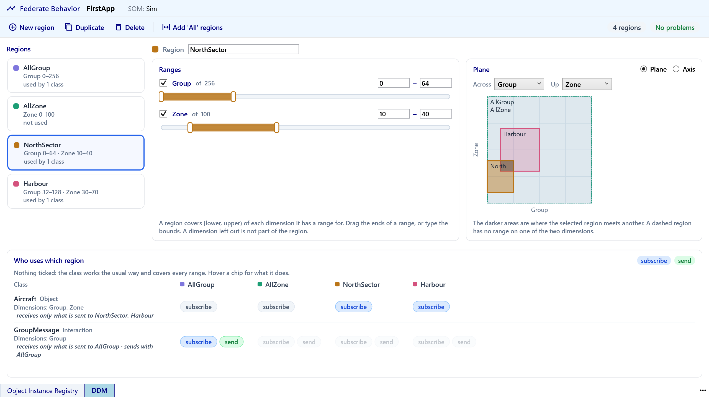
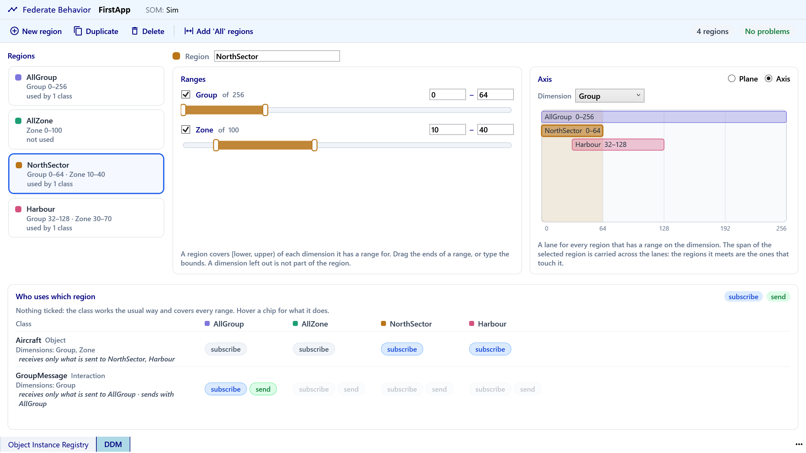

# DDM Design

**Data Distribution Management (DDM)** lets a federate say *where* in the federation's data it is interested and *where* it sends: it works in **regions** made of ranges of the **dimensions** the object model defines. The **DDM** tab of the [Federate Behavior Editor](FederateBehaviorEditor.md) is where you design the regions of a federate application and say which classes use them. The generated code then creates the regions, subscribes the classes and sends with them for you.

For the dimensions themselves see the Dimensions table of the [OME](OME.md). For what the generator makes of the design, see [Code Generator](CodeGenerator.md#7-ddm-regions).



*The DDM tab of a small federate. The selected region, NorthSector, covers Group 0–64 and Zone 10–40; on the plane it meets Harbour in the darker area. The matrix below says that Aircraft subscribes with NorthSector and Harbour, and that GroupMessage subscribes and sends with AllGroup.*

---

## Concepts

| Term | Meaning |
|---|---|
| **Dimension** | A named axis the object model defines, with an upper bound (`Group`, `Zone`). The classes that take part in DDM list the dimensions they have. |
| **Range** | `[lower, upper)` of one dimension: the lower bound is included, the upper one is not. Bounds are whole numbers, the lower one below the upper one, and the upper one at most the dimension's upper bound. |
| **Region** | A named set of ranges, one for each dimension it covers. The federate creates it once and uses it by name. |
| **Use** | What a class does with a region: **subscribe** with it, or **send** with it. |
| **Default region** | What a class without a region works in: it covers every range. A class with no dimension is always in it. |

A federate that subscribes with a region receives what is sent to a region that overlaps it, and nothing else. Subscribing *without* a region is the default region, which covers every range and would defeat the region. So a class that has regions is subscribed with them only; a federate that wants every range uses a region that covers the whole dimension.

---

## The tab

**Toolbar.** *New region*, *Duplicate* and *Delete* (a deleted region takes its uses with it) change the design. *Add 'All' regions* adds the regions that cover a whole dimension that are not there yet. On the right, two chips count the regions and the problems of the design. When there is a problem, a red list under the toolbar says what it is in words. A *use* that no longer applies (the class left the SOM, or lost a dimension of its region in the OME) is listed there with **Remove the use**: the matrix has no row for such a class any more, so this list is the only place the use can be taken out.

**Regions.** One card for every region: its color, name, what it covers (`Group 0–64 · Zone 10–40`), how many classes use it, and a warning mark when something is wrong with it.

**Ranges.** A region is made of the dimensions the SOM defines: **one, two or more of them, as you choose.** For the selected region there is a track for every dimension of the SOM, each with a check box. Tick the dimensions the region covers and leave the others unticked; a new region covers none until you tick one, and a region with no range is reported as a problem. Ticking a dimension gives the region the whole of it to start with. Then drag the ends of the range or the range itself on the track, or type the bounds. Clearing both bounds takes the dimension out of the region. A dimension without an upper bound has no whole to draw, so it is typed in only. A class can use a region only when it has every dimension the region covers (see [Names and rules](#names-and-rules)).

**Plane and axis.** The card on the right shows where the regions lie, in one of two views. The **plane** draws the regions as rectangles on the plane of two dimensions (choose them under *Across* and *Up*): the selected region is drawn strongest, and where it meets another region the area is darker; a region that has a range on one of the two dimensions only is drawn across the other as a dashed band. The **axis** draws one dimension: a lane for every region that has a range on it, with the range in words, and the span of the selected region carried across all the lanes, so the regions it meets are the ones that touch that span. Choose the dimension under *Dimension*. The plane needs two dimensions with an upper bound; the axis needs one, so a model with a single dimension gets the axis. With two or more, switch between the two with *Plane* and *Axis*.



**Who uses which region.** The object model already says which classes the federate publishes and subscribes to, and which dimensions each class has. This table says *where in the data* those classes work: a row for every class that has a dimension, a column for every region. A class with nothing ticked works the usual way, which covers every range.

- **subscribe** — the class is received only when it is sent to a region that overlaps this one. The class is then no longer subscribed the usual way, which would receive every range. Several regions add up: it is received from all of them.
- **send** — the generated manager gets `Send<Class>To<Region>Async`, which sends an interaction of the class with the region. Only an interaction class that the federate publishes can send here; an object is sent with the region of its declaration in the [Object Instance Registry](ObjectInstanceRegistry.md).

A chip is disabled when it cannot apply: the class lacks a dimension of the region, the object model does not subscribe to the class (for *subscribe*), or does not publish it (for *send*). Hover a disabled chip to see which. Under the name of every class a line says what it does now, for example *receives only what is sent to Announcements · sends with Announcements*, or *receives every range (usual subscription)*. A tick on a class the object model does not subscribe or publish is shown as ignored; the generator reports it too (`CG5017`).

What a tick does not do: it does not stop the application from opening regions of its own at run time. A federate whose rooms are numbered while it runs opens one region per room through the generated helper, next to the regions of the design; the tick only fixes what the design says up front.

---

## Regions that cover a whole dimension

The first time the editor opens for an application whose SOM has dimensions, it adds a region for each dimension that has an upper bound: `AllGroup` covers `Group [0, upper bound)`, `AllZone` covers `Zone [0, upper bound)`. A class that wants every range of a dimension subscribes with the matching one. They are ordinary regions: delete the ones you do not want, and they do not come back. *Add 'All' regions* adds the missing ones again.

A region that nothing uses costs nothing: the generator creates only the regions a class or a declaration refers to.

---

## Names and rules

- The name of a region is an identifier (letters, digits and underscores, not starting with a digit), unique in the design, because the generated code names the region by it. A name that is not accepted is not applied; the box shows why.
- A class can use a region only when it has **every** dimension the region covers (IEEE 1516.2-2025: the regions associated with an interaction or an attribute contain only dimensions that are a subset of its available dimensions). SimGe keeps the available dimensions per class, so the rule is checked at class level.
- A region with no range covers no dimension and cannot be created. It is reported when something uses it.

---

## Declarations and regions

A declaration of the [Object Instance Registry](ObjectInstanceRegistry.md) registers its instances in a region of the design: choose it in the **Region** box of the declaration. The box offers the regions the declaration's class can use, and *none*, which is the default region. Declarations and classes that name the same region share it: the generated code creates one region and uses it for all.

A project saved before the DDM design gave each declaration its own ranges. When such a project is opened, every declaration that had ranges gets a named region made of them, named after its class (`VesselRegion`); declarations with the same ranges share one. The project asks to be saved to complete the move.

---

## What is generated

For every region something uses, the simulation manager gets:

| Member | What it does |
|---|---|
| `Get<Region>RegionAsync()` | Creates and commits the region the first time it is asked for, and returns its handle. |
| Subscriptions | When the federation is ready, every class that subscribes with a region is subscribed with it (interaction classes, and the attributes of object classes). The class is **not** subscribed the usual way. |
| `Send<Class>To<Region>Async(dto)` | Sends an interaction of the class with the region. |
| `<Class>ReceivedIn<Region>Region` | An event for an interaction class that subscribes with the region: raised with the message (and its tag) when it was sent to a region that overlaps the region of the design. |
| Cleanup | Before the federate resigns, the subscriptions are removed and the regions deleted. |

```csharp
// The design: NorthSector = Group 0, 64); ChatMessage subscribes and sends with it.
await SendChatMessageToNorthSectorAsync(new ChatMessage { Content = "hello" });
RegionHandle north = await GetNorthSectorRegionAsync();     // for your own RTI calls

// What was sent to the region arrives as an event of its own, apart from the traffic of other regions.
ChatMessageReceivedInNorthSectorRegion += (message, qos) => Show(message);
```

The event is raised on the thread of the manager's `EventContext`, like the other events of the manager. The match reads the ranges of the regions the message was sent to while it is being received (IEEE 1516.1-2025 §9.1.7) and applies the overlap rule of §9.1.4: every dimension the two regions have in common overlaps, and they have one in common. A federate that has no handler does no matching. Object classes have no such event: an object is discovered, and its updates are reflected, through the subscription regions.

The helpers for the interaction classes of the model (`GroupRegions.OpenRegionAsync(...)`) stay available for regions you open yourself at run time. The generator reports what it cannot generate: a region that cannot be created, a class that lacks a dimension of its region, a use of a class the federate does not subscribe or publish, and a class that left the SOM (`CG5013` – `CG5019`, see [Code Generator).

---

## Saving

The design is saved with the behavior of the application, in the `Ddm` part of `Behavior\‹application›.sfbm` (file format 2): the regions with their ranges by dimension name, and the uses by class name. A design with nothing in it writes nothing. Dimensions and classes are found again by name when the project is opened or the application's SOM changes; what cannot be found stays in the design, marked, so nothing is lost silently.

---

**Previous:** [Object Instance Registry](ObjectInstanceRegistry.md) · **Next:** [Diagram Editor](Diagrams.md)

---
Updated October 9, 2026
