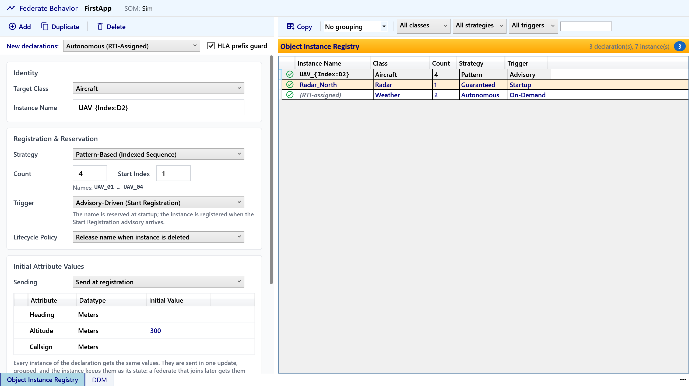

# FBE — Federate Behavior Editor

A federate's **SOM** says what it publishes and subscribes to. It does not say what the federate *does* at run time: which object instances it registers, which regions it works in, or when. That is the **behavior** of the federate application, and the **Federate Behavior Editor (FBE)** is where you model it.

For the object model itself see [OME — Object Model Editor](OME.md). For the federate applications see [FAME](FAME.md). For what the generator makes of the behavior, see [Code Generator](CodeGenerator.md).

---

## What a behavior is

A federation architecture is a FOM plus a model of the behavior of each participating federate. SimGe keeps that behavior **per federate application**, not per SOM:

- Two applications may use one SOM and still behave differently — one registers a `Weather` instance, the other a `Radar`. Each application has its own behavior, and each edits its own.
- A behavior is saved in its own file, `Behavior\‹application›.sfbm`, in the project folder. The `.sfam` file links to it by a `BehaviorId`, so renaming the application or the file does not break the link.
- A behavior belongs to an application, so an application without a SOM has nothing to declare yet: the editor says so and offers the tabs once a SOM is assigned in [FAME](FAME.md).

What a behavior holds today:

| Tab | Holds | Chapter |
|---|---|---|
| **Object Instance Registry** | The object instances the federate registers: class, naming strategy, trigger, initial attribute values and region scope. | [Object Instance Registry](ObjectInstanceRegistry.md) |
| **DDM** | The regions the federate works in, with the ranges they cover, and which classes subscribe with them or send with them. | [DDM Design](DdmDesign.md) |

*The editor of one federate application, here with the Object Instance Registry tab open.*

---

## Opening the editor

Each federate application has its own editor tab, named **FBE (‹application›)**. Open it from any of these:

- the **Behavior** node under the application in the [Project Explorer](ProjectExplorer.md) — double-click it, or choose **Open in Editor** from its context menu. Its children, **Object Instance Registry** and **DDM**, open the editor on that tab;
- the **Federate Behavior…** command in the context menu of the application node;
- **View ▸ Project Workspace ▸ Federate Behavior ▸ ‹application›**;
- the command search box: **Open behavior of ‹application›**.

Opening it again brings the existing tab to the front, on the tab of the editor you were using: the editor remembers it while the workspace is open, also when you work in another workspace in between. The DDM tab opens with its first region selected.

---

## The workspace

The band at the top names the application and the SOM its behavior is declared against. Below it are the tabs, at the bottom of the workspace like those of the OME.

- Changing a declaration marks the project as modified; the behavior is written with the project (**File ▸ Save**).
- Renaming the application renames the tab.
- Assigning another SOM to the application in FAME gives the registry and the DDM design that SOM's classes and dimensions. A declaration whose class the new SOM does not have stays in the list with an error, so you can choose another class or delete it.
- Removing the application closes its editor.

---

## Saving

| What | Where |
|---|---|
| The behavior of an application | `Behavior\‹application›.sfbm` (JSON; enumerations by name; file format 2). Omitted data, such as an empty registry or an empty DDM design, is not written. |
| The link to the behavior | `BehaviorId` in the application's entry in the `.sfam`. |

The `.sfbm` file is separate from the module files, which stay standard: the module's `.xml` content file is a plain IEEE 1516.2 object model, and the behavior does not appear in exported FDD or FED files.

### Projects saved before behavior models

Older projects kept the instance declarations in the metadata (`.sfom`) of the SOM module. When such a project is opened, SimGe moves them: **every** application that uses the SOM gets the declarations in its behavior, the module stops storing them, and the project asks to be saved to complete the move. After saving you will find the new `Behavior` folder next to `Fom` and `Fam`.

Applications that shared one SOM start with identical declarations; from then on each application's declarations are its own.

---

**Previous:** [OME — Object Model Editor](OME.md) · **Next:** [Object Instance Registry](ObjectInstanceRegistry.md), [DDM Design](DdmDesign.md)

---
Updated October 9, 2026
