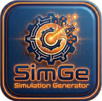

# SimGe

Simulation Generator

A Windows desktop environment for **High Level Architecture (HLA)** object modeling, federation architecture design, and federate code generation — connecting model editing and analysis with generation for the **Fora** IEEE 1516-2025 client and inspection of captured telemetry.

[Download SimGe](Downloads.md){ .md-button .md-button--primary }
[Read the manual](UserManual.md){ .md-button }
[Explore features](Features.md){ .md-button }

IEEE 1516-2025 / HLA 4.NET 10OMDE & FAMEC# CodeGenFora Native

<a class="simge-hero__feedback" href="https://sites.google.com/view/okantopcu/contact" target="_blank" rel="noopener" title="Questions, issues or ideas? Get in touch."><svg viewBox="0 0 24 24" aria-hidden="true"><path d="M20 2H4c-1.1 0-2 .9-2 2v18l4-4h14c1.1 0 2-.9 2-2V4c0-1.1-.9-2-2-2m0 14H5.17L4 17.17V4h16z"/></svg>Feedback</a><a class="simge-hero__feedback simge-hero__sponsor" href="https://github.com/sponsors/otopcu" target="_blank" rel="noopener" title="SimGe is free. Support its development on GitHub Sponsors."><svg viewBox="0 0 24 24" aria-hidden="true"><path d="M12 21.35l-1.45-1.32C5.4 15.36 2 12.27 2 8.5 2 5.41 4.42 3 7.5 3c1.74 0 3.41.81 4.5 2.08C13.09 3.81 14.76 3 16.5 3 19.58 3 22 5.41 22 8.5c0 3.77-3.4 6.86-8.55 11.53L12 21.35z"/></svg>Sponsor</a>

## Highlights

-   :material-layers-triple-outline:{ .lg .middle } **Built for HLA 4 & Beyond**

    ---

    Full lifecycle support for IEEE 1516-2025 (HLA 4), IEEE 1516-2010 (HLA Evolved), and HLA 1.3 FED/FDD files.

-   :material-cube-outline:{ .lg .middle } **Object Modeling & OMT (OMDE)**

    ---

    Create and edit modular FOMs and SOMs with standard OMT tables, visual diagrams, an instance registry, and continuous rule validation.

-   :material-vector-polyline:{ .lg .middle } **Federation Architecture (FAME)**

    ---

    Design federate applications, assign model associations, inspect federation structure, and describe execution topology.

-   :material-code-braces:{ .lg .middle } **Native Fora Client CodeGen**

    ---

    Generate clean, production-grade C# / .NET 10 integration code natively targeting the Fora IEEE 1516-2025 client SDK.

-   :material-chart-bell-curve-cumulative:{ .lg .middle } **Quantitative Model Analysis**

    ---

    Compare saturation, payload dispersion, and calibration sensitivity across modules using published structural metric formulas.

-   :material-chart-timeline-variant:{ .lg .middle } **Post-Run Telemetry Inspection**

    ---

    Inspect recorded simulation executions with timeline analysis, payload correlation, and transport drift diagnostics.

## User Manuals

-   :material-book-open-page-variant:{ .lg .middle } **User Manual Overview**

    ---

    Complete workflow guide: workspace concepts, project configuration, modeling, code generation, and analysis.

    [:octicons-arrow-right-24: Read the manual](UserManual.md)

-   :material-table-edit:{ .lg .middle } **Object Model Editor (OME)**

    ---

    Author object classes, interaction classes, attributes, parameters, and datatypes with full OMT compliance and validation.

    [:octicons-arrow-right-24: Read the manual](UserManual/OME.md)

-   :material-sitemap:{ .lg .middle } **Federation Architecture (FAME)**

    ---

    Model federate applications, assign module associations, configure behavior models, and inspect federation topology.

    [:octicons-arrow-right-24: Read the manual](UserManual/FAME.md)

-   :material-code-tags:{ .lg .middle } **Code Generator**

    ---

    Generate layered .NET 10 / C# federate applications, datatypes, codecs, and lifecycle scaffolding for Fora.

    [:octicons-arrow-right-24: Read the manual](UserManual/CodeGenerator.md)

-   :material-monitor-dashboard:{ .lg .middle } **Object Model Analysis & Dashboard**

    ---

    Evaluate structural complexity, payload sizing, propensity curves, and diagnostic sensitivity metrics across FOM modules.

    [:octicons-arrow-right-24: Read the manual](UserManual/Dashboard.md)

-   :material-chart-timeline-variant:{ .lg .middle } **Telemetry Inspector Visualizer**

    ---

    Inspect captured runtime telemetry, examine message delivery latencies, payload sizes, and transport performance.

    [:octicons-arrow-right-24: Read the manual](UserManual/TelemetryVisualizer.md)

## Workspaces & Capabilities

### Modeling & Architecture

-   :material-file-tree-outline:{ .lg .middle } **Object Modeling Environment (OMDE)**

    ---

    Create and modify modular FOMs and SOMs. Features OMT tabular editors, FED and IEEE 1516-2010/2025 FDD import/export, class diagrams, and automated validation against HLA rules.

    [:octicons-arrow-right-24: Explore Features](Features.md#object-model-development-environment-omde)

-   :material-sitemap-outline:{ .lg .middle } **Federation Architecture Modeling (FAME)**

    ---

    Define federate applications, their publication and subscription responsibilities, and module mappings. Generates federation execution descriptions and behavior models.

    [:octicons-arrow-right-24: Explore Features](Features.md#federation-architecture-modeling-environment-fame)

### Engineering & Analysis

-   :material-cog-sync-outline:{ .lg .middle } **Code Generator**

    ---

    Produce platform-ready, layered C# / .NET 10 code targeting the [Fora client](https://sites.google.com/view/okantopcu/fora){ target="_blank" rel="noopener" }. Generates federate lifecycle management, object/interaction models, and codecs.

    [:octicons-arrow-right-24: Explore Features](Features.md#code-generator-cg)

-   :material-chart-box-outline:{ .lg .middle } **Analysis, Reports & Telemetry**

    ---

    Compute structural metrics based on [published scientific research](https://doi.org/10.1016/j.simpat.2026.103328){ target="_blank" rel="noopener" }, export HTML/PDF reports, and visualize post-run telemetry datasets.

    [:octicons-arrow-right-24: Explore Features](Features.md#object-model-analysis)

## Getting Started

Start developing HLA federations with SimGe:

1. **Install SimGe:**
   Download the latest installer from the [Downloads](Downloads.md) page. SimGe runs on Windows 10/11 (64-bit) and requires the **.NET 10 Desktop Runtime (x64)**. Review [Installation & Updates](UserManual/Installation.md) for prerequisites and setup guidance.

2. **Explore Bundled Samples:**
   Launch SimGe and open one of the bundled sample projects:
   - **Chat:** A lightweight HLA federation demonstrating basic object and interaction messaging.
   - **STMS:** Space Trajectory Management System, showcasing modular FOMs, complex datatypes, and federate applications.

3. **Follow the Quick Start:**
   Walk through the [Quick Start Guide](UserManual/QuickStart.md) to create a project, edit an object model, configure code generation, and produce your first .NET federate.

## Solution Architecture

SimGe integrates modeling, architecture, code generation, and empirical analysis in a unified toolchain:

| Environment | Scope & Capabilities |
| :--- | :--- |
| **OMDE** — Object Modeling | OMT tables, modular FOMs/SOMs, class inheritance, datatype dictionaries, FED/FDD translation, automated rule validation |
| **FAME** — Federation Architecture | Federate applications, publication/subscription matrices, behavior models (SFBM), federation execution topology |
| **Code Generator** | Layered C# 14 / .NET 10 code synthesis, Fora client integration, FOM-to-code mapping, datatype codecs |
| **Analysis & Diagnostics** | Structural model complexity metrics, payload analysis, diagnostic reports, experimental Telemetry Visualizer |

## Technical Specifications

| Specification | Details |
| :--- | :--- |
| **Target OS** | Windows 10 / Windows 11 (64-bit) |
| **Runtime** | Microsoft .NET 10.0 Desktop Runtime (x64) |
| **Supported Standards** | IEEE 1516-2025 (HLA 4), IEEE 1516-2010 (HLA Evolved), HLA 1.3 |
| **Supported Formats** | HLA 1.3 FED, IEEE 1516 FDD (XML Schema), SimGe Project (`.fap`), Modular FOM (`.sfom`, `.sfam`, `.sfbm`) |
| **Code Generation Target** | C# 14 / .NET 10 targeting the [Fora client](https://sites.google.com/view/okantopcu/fora){ target="_blank" rel="noopener" } (IEEE 1516-2025 Federate Protocol) |
| **UI Framework** | WPF (.NET 10) |
| **Installer** | Windows Installer (`SimGe.msi`) authored with WiX Toolset v6 |

## Documentation & Links

- **[Features](Features.md)** — Comprehensive overview of modeling, architecture, generation, and analysis capabilities.
- **[User Manual](UserManual.md)** — In-depth guide covering workspaces, OME, FAME, and code generation.
- **[What's New](WhatsNew.md)** — Release highlights for SimGe 0.5.3 (October 8, 2026).
- **[Release Notes](ReleaseNotes.md)** — Full release history and verification logs.
- **[SimGe Project Page](https://sites.google.com/view/okantopcu/simge){ target="_blank" rel="noopener" }** — Official project portal.
- **[Fora Client & RTI](https://sites.google.com/view/okantopcu/fora){ target="_blank" rel="noopener" }** — Companion IEEE 1516-2025 runtime and SDK.
- **[SimGe on X / Twitter](https://twitter.com/OTOT_SimGe){ target="_blank" rel="noopener" }** — Announcements and updates.
- **[SimGe User's Forum](https://groups.google.com/d/forum/otot_simge){ target="_blank" rel="noopener" }** — Community discussion group.

## License & Credits

**Author:** Okan Topcu · **Copyright** © 2011–2026 oToT

SimGe is free. If it helps your work, you can [support its development](https://github.com/sponsors/otopcu){ target="_blank" rel="noopener" } on GitHub Sponsors.

!!! note "Disclaimer"

    SimGe is a free academic research toolbox provided "as is", without warranty or guaranteed support, for research and educational use only. Read the full [Disclaimer](Disclaimer.md).
